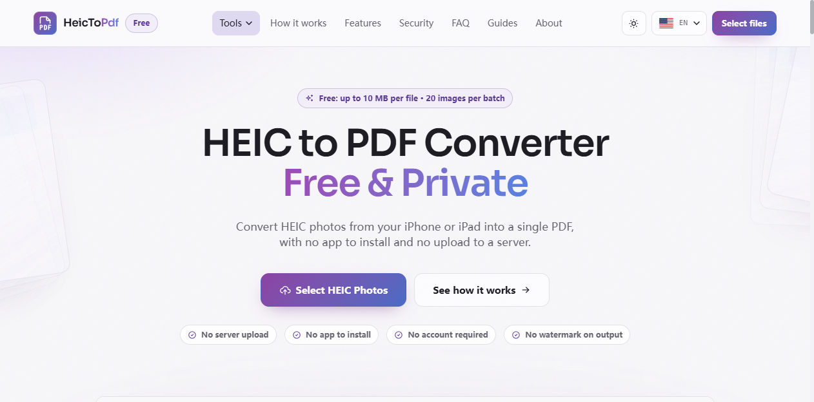
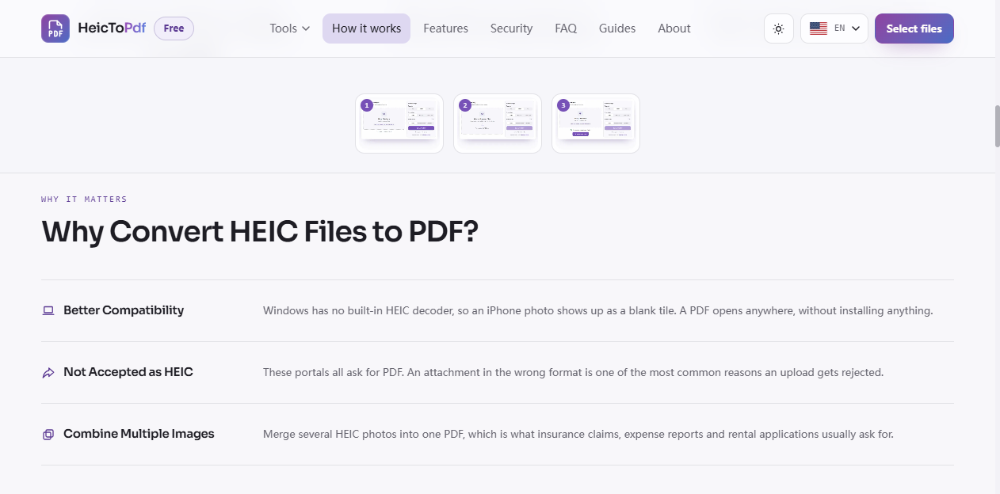
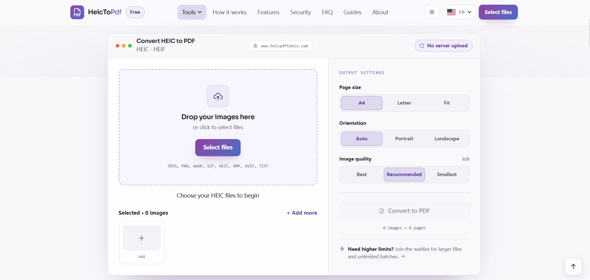
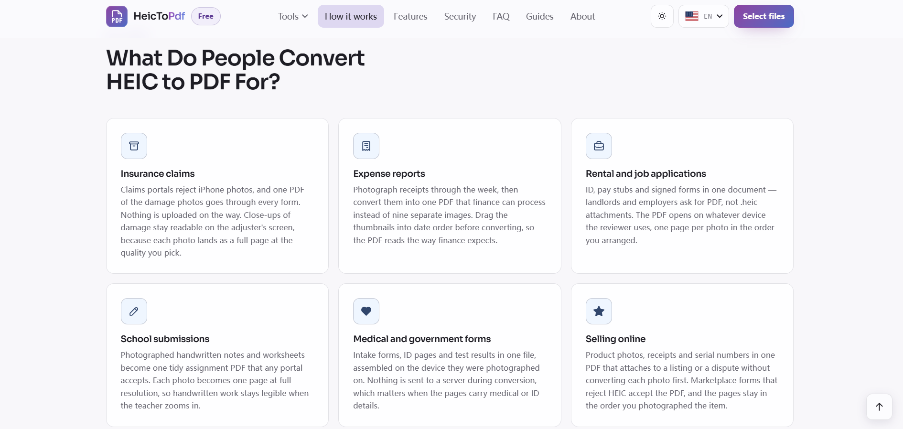

# HeicToPDF — Free, Private HEIC and PDF Tools That Run in Your Browser

HeicToPDF is a free online toolkit built around one practical problem: iPhone and iPad photos save as HEIC by default, but most of the world — Windows PCs, Android devices, upload portals, and printers — cannot open HEIC. [HeicToPDF](https://www.heicpdftools.com) turns those photos (and other images) into PDFs and handles related PDF tasks, entirely inside your browser. There is no software to install, no account to create, and your files are never uploaded to a server.

Here is the homepage — a clear converter view with the free limits shown up front:

## Who It's For

HeicToPDF is aimed at everyday people who receive or shoot HEIC photos and then need those photos to behave like normal documents:

- **iPhone and iPad users** who want to share or submit photos without fighting the HEIC format.
- **Anyone assembling documents from images** — receipts, ID pages, signed forms, homework, product photos.
- **People who must upload to strict portals** — insurance claims, expense reports, rental or job applications, medical and government intake forms — that reject HEIC and ask for PDF.
- **Privacy-conscious users** who will not send sensitive photos (an ID, a medical form, a signed contract) to a third-party server.

## What Problems It Solves

HEIC is efficient but poorly supported. The site removes that friction in several concrete ways:

- **Compatibility.** Windows has no built-in HEIC decoder; an iPhone photo shows up as a blank tile. A PDF opens anywhere, with nothing to install.
- **Submission.** Claims, applications, and intake forms routinely reject HEIC attachments. Converting to PDF clears that rejection.
- **Combining images.** Several HEIC photos become one multi-page PDF — exactly what insurance claims, expense reports, and rental applications ask for.
- **No install, no sign-up.** You open the page and convert; there is no app, extension, or account in the way.

## What It Does

The site centers on a free, browser-based HEIC to PDF converter, with related image-to-PDF and PDF tools around it. The converter itself:

- Converts HEIC and HEIF photos into a single PDF.
- Merges multiple images into one document, one photo per page, in the order you arrange.
- Lets you set page size (A4, Letter, or Fit), orientation (Auto, Portrait, Landscape), and image quality.
- Accepts JPEG, PNG, WebP, GIF, HEIC, BMP, AVIF, and TIFF as input.
- Runs completely in your browser — decoding and PDF assembly happen on your device.

All tools are free, require no registration, add no watermark, and need no upload.

## Common Uses

People reach for the converter in situations where a photo has to become a submittable document:

- **Insurance claims** — one PDF of damage photos goes through every form.
- **Expense reports** — photographed receipts become one PDF finance can process.
- **Rental and job applications** — ID, pay stubs, and signed forms in one file reviewers can open on any device.
- **School submissions** — photographed notes and worksheets become one assignment PDF.
- **Medical and government forms** — assembled on the device, nothing sent to a server.
- **Selling online** — product photos, receipts, and serial numbers in one PDF that marketplaces accept.

## Why "Private" Matters Here

Privacy is not a tagline; it is how the converter is built. Your photos are read and converted inside the browser tab. There is no upload step and no storage step, so an image of your ID, a receipt, or a signed form never leaves the device it was opened on, and your originals are not modified.

## Why Use It

- **Free**, with no account and no watermark.
- **Private by design** — files are not uploaded and stay on your device.
- **Simple** — open the page, select photos, convert, download.
- **Broad device support** — iPhone, iPad, Mac, Windows, and Android, on Chrome, Edge, Safari, Firefox, and Samsung Internet.

---

HeicToPDF keeps HEIC and PDF handling free, private, and entirely in your browser.
